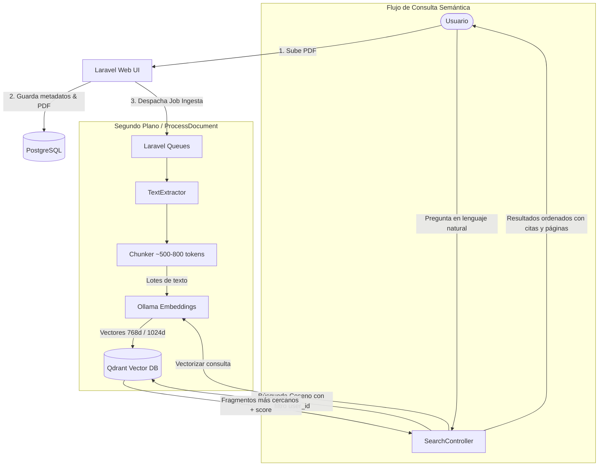

# SemanticDocs 📑🔍
> **Buscador Semántico de Documentos** impulsado por Laravel, Qdrant y Embeddings locales (Ollama).

[English Version Below](#english-version)

---

## 🇪🇸 Español

### 1. Descripción
**SemanticDocs** es una aplicación web en Laravel que permite a los usuarios subir documentos (PDF o texto) y realizar búsquedas **por significado**, y no únicamente por coincidencia exacta de palabras clave.

Por ejemplo, buscar:
> *"¿cuándo puedo dar de baja una materia?"*

encuentra el artículo exacto del reglamento escolar aunque el texto oficial hable de *"solicitud de desincorporación temporal de asignaturas ante servicios escolares"*.

---

### 2. Arquitectura del Sistema



---

### 3. Stack Tecnológico

| Capa | Tecnología | Rol |
|---|---|---|
| **Backend / Web** | Laravel 11/12 (PHP 8.3) | Rutas, Eloquent ORM, Colas, Auth, Controladores |
| **BD Relacional** | PostgreSQL 16 | Usuarios, documentos, estados, páginas y auditoría |
| **BD Vectorial** | Qdrant | Colección `document_chunks`, índice Cosine, filtros por payload |
| **Embeddings** | Ollama (`nomic-embed-text` / `bge-m3`) | Generación de vectores de alta fidelidad en local |
| **Colas** | Laravel Database Queue | Procesamiento asíncrono de extracción y vectorización |
| **Frontend** | Blade + Tailwind CSS / Livewire | Interfaz reactiva para subida y visualización |
| **Infraestructura** | Docker Compose | Contenedores para PostgreSQL y Qdrant |

---

### 4. Colección Vectorial (`document_chunks`)
- **Métrica de Distancia:** Cosine
- **Dimensiones:** 768 (con `nomic-embed-text`) o 1024 (con `bge-m3`)
- **Payload por punto:**
  - `user_id` (integer, indexado para aislamiento de datos multiusuario)
  - `document_id` (integer, indexado para eliminación en cascada)
  - `chunk_index` (integer)
  - `page` (integer)
  - `title` (string)
  - `text` (string)

---

### 5. Puesta en marcha rápida

#### Prerrequisitos
1. **PHP 8.3+** y **Composer** instalados.
2. **Docker Desktop** (para PostgreSQL y Qdrant).
3. **Ollama** con el modelo de embeddings:
   ```bash
   ollama pull nomic-embed-text
   # o bien: ollama pull bge-m3
   ```

#### Instalación y configuración
```bash
# 1. Clonar o entrar al directorio
cd semanticdocs

# 2. Levantar la base de datos y la base vectorial
docker compose up -d

# 3. Configurar variables de entorno en .env
cp .env.example .env
php artisan key:generate

# 4. Ejecutar migraciones
php artisan migrate

# 5. Probar el pipeline vectorial (Etapa 1)
php artisan semanticdocs:test-stage1 --reset

# 6. Ingestar y vectorizar un documento PDF o de texto (Etapa 2)
php artisan semanticdocs:ingest ruta/al/documento.pdf --title="Título del Documento" --sync
```

#### Parámetros en `.env`
```env
DB_CONNECTION=pgsql
DB_HOST=127.0.0.1
DB_PORT=5432
DB_DATABASE=semanticdocs
DB_USERNAME=app
DB_PASSWORD=secret

QDRANT_HOST=http://127.0.0.1:6333
QDRANT_COLLECTION=document_chunks

OLLAMA_HOST=http://127.0.0.1:11434
OLLAMA_EMBED_MODEL=nomic-embed-text
OLLAMA_EMBED_DIM=768
```

---

### 6. Roadmap por Etapas

- [x] **Etapa 1: Núcleo Vectorial y Qdrant**
  - [x] Conexión con PostgreSQL 16 y Qdrant.
  - [x] Servicio cliente `QdrantClient` (`createCollection`, `upsertPoints`, `search`, `delete`).
  - [x] Servicio embedder `OllamaEmbedder` (`embed`, `embedBatch`).
  - [x] Comando artisan `semanticdocs:test-stage1` con textos de reglamentos en español y pruebas de similitud semántica.
- [x] **Etapa 2: Ingesta de Documentos en Segundo Plano**
  - [x] Migración y modelo `Document` (`pending`, `processing`, `ready`, `failed`).
  - [x] Servicio `TextExtractor` (extracción multi-página de PDFs y texto con `smalot/pdfparser`).
  - [x] Servicio `Chunker` (fragmentación con overlap configurable de ~10-15%).
  - [x] Job en cola `ProcessDocument` con generación de embeddings en lotes y actualización de estados.
  - [x] Comando artisan `semanticdocs:ingest` para pruebas directas o asíncronas vía colas.
  - [x] Suite de tests automatizados unitarios y de integración para la ingesta.
- [ ] **Etapa 3: Búsqueda y UI**
  - [ ] Controlador `SearchController` y `DocumentController`.
  - [ ] Formulario de búsqueda con score de confianza y fragmento resaltado.
  - [ ] Dashboard de documentos subidos con estado de procesamiento.
- [ ] **Etapa 4: Autenticación y Aislamiento Multiusuario**
  - [ ] Integración de Breeze.
  - [ ] Filtro estricto de `user_id` en Qdrant.
  - [ ] Eliminación en cascada (al borrar un documento en PostgreSQL, se eliminan sus vectores en Qdrant).
- [ ] **Etapa 5: Calidad, CI y Tests**
  - [ ] Tests con Pest/PHPUnit simulando llamadas HTTP a Qdrant y Ollama.
  - [ ] Pipeline en GitHub Actions.
- [ ] **Etapa 6 (Extra): RAG Local**
  - [ ] Pasar los fragmentos a un LLM local (`llama3.2`, `qwen2.5`) para generar respuestas sintetizadas con citas.
- [ ] **Etapa 7 (Extra): Conexión con n8n**
  - [ ] Webhook / API para bots de Telegram o WhatsApp.

---

<a name="english-version"></a>
## 🇺🇸 English

### Overview
**SemanticDocs** is a Laravel-powered semantic search engine for documents (PDF/Text) using Qdrant vector database and local Ollama embeddings. It enables meaning-based queries rather than exact keyword matching.

### Core Features
- Vector search using **Cosine Distance**.
- Strict tenant/user data isolation using Qdrant payload filters (`user_id`).
- Local, privacy-first embedding generation via Ollama.
- High-performance asynchronous background processing for document chunking and ingestion.

---
*Desarrollado con ❤️ para potenciar la búsqueda inteligente de conocimiento.*
